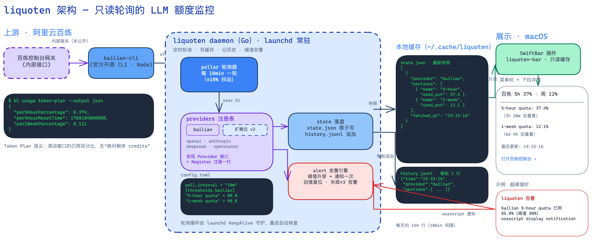

# liquoten

macOS 菜单栏实时显示 LLM 额度/余额的轻量监控工具。只读轮询各 provider 的余额接口，不站在你的请求链路上。



> 架构图为可编辑的 Excalidraw 源文件：[docs/liquoten-architecture.excalidraw](docs/liquoten-architecture.excalidraw)（拖入 excalidraw.com 或 VS Code 插件编辑）

- **当前支持**：阿里云百炼 Token Plan、Claude Code 订阅（Pro/Max），5 小时 / 1 周滚动配额（百炼按月计费的套餐为月度配额）百分比 + 重置倒计时
- **形态**：原生 Swift 菜单栏 App（Liquoten.app）+ Go daemon；阈值升穿发 macOS 系统通知
- **通用性**：新增 provider = 实现 `providers.Provider` 接口 + 一行注册，展示层无需改动

## 工作原理

```
bailian-cli (官方 CLI)  →  daemon 每 15min 轮询  →  state.json / history.jsonl
                                                 ↘ 阈值升穿 → notifications.jsonl
state.json          ← Liquoten.app 只读渲染菜单栏
notifications.jsonl ← Liquoten.app 消费并投递系统通知
```

一次轮询：对每个启用的 provider 调 `Query()`，结果落盘缓存（原子写）并追加历史，然后过阈值状态机（升穿发一次通知，回落复位，重启后状态不丢）。

daemon 由 App 作为子进程拉起（意外退出 5 秒后自动重启）；App 只读 daemon 写出的文件，60 秒刷新一次菜单栏，两个进程各管各的，无共享内存。

## 安装

前置：Go ≥ 1.21（`brew install go`，go.mod 会自动拉取 1.27 工具链）、Node ≥ 22.12、Xcode Command Line Tools（`xcode-select --install`，编译 Swift 需要）。

```bash
# 1. 安装官方百炼 CLI（liquoten 的百炼 adapter 通过它查询）
npm install -g bailian-cli
bl auth login --console                  # 浏览器登录控制台（国际站加 --console-site international）；也可装好 App 后在菜单里点"登录百炼"

# 2. 配置（可选，默认配置即可跑，见下方"配置"）
mkdir -p ~/.config/liquoten
cp config.example.toml ~/.config/liquoten/config.toml

# 3. 构建并安装 App
cd ~/code/liquoten-cred
./app/build.sh
mv build/Liquoten.app /Applications/      # 建议放 /Applications（"开机自动启动"依赖 bundle 路径稳定）

# 4. 启动
open /Applications/Liquoten.app
```

首次启动后系统会请求通知权限，允许即可。菜单栏点开下拉菜单可勾选"开机自动启动"（SMAppService 登录项，App 自带的开关，无需手写 plist）。

注意：App 从 Finder 启动时 PATH 里没有 `bl`（npm 全局目录不在其中）。如果 daemon 报 `bl: command not found`，在 `config.toml` 里写死绝对路径：

```toml
[providers.bailian]
command = "/opt/homebrew/bin/bl"   # 用 `which bl` 查到实际路径
```

## Claude Code 订阅用量

Claude Code 会把订阅用量（`rate_limits.five_hour` / `seven_day` 的 `used_percentage`、`resets_at`）通过 stdin 传给 [statusLine](https://code.claude.com/docs/en/statusline) 命令。`liquoten statusline` 子命令把它落盘到 `~/.cache/liquoten/claudecode.json`，同时在 Claude Code 底部打印 `[Opus 5.5] 5h 23% · 周 41%`；daemon 的 `claudecode` provider 只读这个文件，不碰 OAuth 凭证、不调未公开接口。

1. `~/.claude/settings.json` 加：

   ```json
   "statusLine": {
     "type": "command",
     "command": "/Applications/Liquoten.app/Contents/Resources/liquoten statusline"
   }
   ```

2. `~/.config/liquoten/config.toml` 加 `[providers.claudecode]`（阈值见 config.example.toml）

边界：数据只在使用 Claude Code 时更新（会话首次响应后才有）；订阅额度与 claude.ai 网页端共享，只在网页端用时菜单栏会滞后，下次打开 Claude Code 即对齐。窗口过了 `resets_at` 显示 0%。"上次更新"取 statusline 落盘时间。

## 菜单栏

标题形如 `百炼 5h 37% · 周 12%`（多 provider 用 `·` 连接），有 provider 查询失败时显示 `百炼 出错`。标题左侧有环形进度图标：每个有百分比语义的 section 一个（最多 4 个），从 12 点方向顺时针填充已用比例，颜色按用量分档——<70% 蓝、70–90% 橙、≥90% 红。下拉菜单包含：

- 各窗口百分比与重置倒计时（`（3h20m 后重置）`）
- 上次更新时间
- 登录百炼（国内站 / 国际站）：调用 `bl auth login --console` 打开浏览器登录，成功后自动重启 daemon 刷新
- 打开百炼控制台 / Claude 用量页、打开数据目录、立即刷新（重启 daemon，立刻轮询一次）
- 开机自动启动开关、退出

daemon 缺失或尚未轮询时显示 `liquoten` 与对应提示。

## 通知

默认（`notify = "app"`）daemon 把告警事件追加写入 `~/.cache/liquoten/notifications.jsonl`，由 Liquoten.app 消费并投递系统通知——好处是通知归属 App（图标、通知中心管理都正常），daemon 无需自己弹窗。事件只追加不删除，App 用事件 id 游标去重，重启不重发。

如果不想跑 App（比如走下面的 SwiftBar 路线），配置 `notify = "osascript"` 退回 daemon 自己发通知。

## 配置

见 [config.example.toml](config.example.toml)。默认阈值：5 小时窗口 80%、周窗口 90%，升穿时发一次系统通知，回落后复位（下次升穿再告警）。百炼 Token Plan 用量查询依赖 `bl auth login --console` 的控制台登录态（API key 只用于模型调用，查不到用量）；`api_key` 字段仍会以 `DASHSCOPE_API_KEY` 传给 bl。

环境变量：

| 变量 | 作用 |
|---|---|
| `DASHSCOPE_API_KEY` | 百炼 API key（bailian-cli 读取；用量查询仍需控制台登录） |
| `LIQUOTEN_CONFIG` | 覆盖默认配置文件路径（`~/.config/liquoten/config.toml`） |
| `LIQUOTEN_CACHE_DIR` | 覆盖默认缓存目录（`~/.cache/liquoten`） |

daemon flags：`-config`（配置文件）、`-once`（只轮询一次）、`-cache-dir`（缓存目录）。子命令 `liquoten login [-site domestic|international] bailian` 执行控制台登录（菜单"登录百炼"即调用它）。

## 验证

```bash
go test ./... && go vet ./... && test -z "$(gofmt -l .)"   # 单测 + 静态检查

~/code/liquoten-cred/build/Liquoten.app/Contents/Resources/liquoten -once   # 跑一轮 daemon
cat ~/.cache/liquoten/state.json                            # 与控制台百分比对比
```

手工场景：把 `config.toml` 阈值临时调低（如 10%）再 `-once`，应弹系统通知；临时断网，菜单栏应显示错误态。单测覆盖：百炼 JSON 解析（录制 fixture，CLI 输出格式变了测试先红）、阈值状态机（含重启持久化）、store 原子写回读、config 合并、FileNotifier 事件追加。

## 扩展新 provider

1. 新建 `internal/providers/<name>/<name>.go`，实现 `providers.Provider` 接口并在 `init()` 里 `providers.Register`
2. 在 `cmd/liquoten/main.go` 里 `import _` 该包（注册入口）
3. 配置里加 `[providers.<name>]` 与 `[thresholds.<name>]`

各 provider 的余额语义不同，统一归一化为 `Section{Name, UsedPct, Remaining, ResetAt}`（无对应语义的字段置 -1）：

| Provider | 查询接口 | 语义 |
|---|---|---|
| 百炼 Token Plan | 官方 CLI `bl usage token-plan --output json` | 5h/周/月窗口已用百分比（只展示套餐实际返回的窗口） |
| Claude Code 订阅 | statusLine stdin 的 `rate_limits`（`liquoten statusline` 落盘） | 5h/周窗口已用百分比 |
| OpenAI / Codex | `GET api.openai.com/v1/dashboard/billing/subscription` | hard/soft limit USD；ChatGPT 订阅套餐无接口 |
| Anthropic API（按量） | Admin API `GET /v1/organizations/cost_report` | 本月累计费用 |
| DeepSeek | `GET api.deepseek.com/user/balance` | 剩余 CNY |
| OpenRouter | `GET openrouter.ai/api/v1/credits` | 剩余 credits |

（表内百炼、Claude Code 以外的接口为设计期核对的接入点，实现时需用真实 key 再验证。）

## 项目结构

```
app/                    Liquoten.app 源码（Swift：菜单栏 + 通知消费 + daemon 看门狗）
  build.sh              打包脚本（swiftc + go build，产出 build/Liquoten.app）
cmd/liquoten/           daemon 入口（轮询循环、由 App 或 launchd 常驻）
internal/config/       配置加载（TOML + 环境变量）
internal/providers/    Provider 接口 + 注册表
  bailian/             百炼 adapter（exec bailian-cli + fixture 单测）
  claudecode/          Claude Code adapter（statusline 落盘 + 读快照）
internal/store/        state.json 原子写 + history.jsonl 追加
internal/alert/        阈值状态机 + 通知通道（FileNotifier / osascript）
swiftbar/              菜单栏插件（xbar 协议输出，legacy 路线）
launchd/               com.liquoten.plist（legacy 路线）
docs/                  架构图（.excalidraw 可编辑源文件 + PNG 预览）
```

## 故障排查

| 症状 | 处理 |
|---|---|
| 菜单栏显示 `liquoten ✕` | daemon 二进制缺失，App bundle 不完整，重新 `./app/build.sh` |
| 菜单栏一直 `liquoten` | 等首次轮询（启动即轮询）；仍不行看日志 `tail ~/Library/Logs/liquoten.log` |
| 百炼报 `No console access token found` | 菜单里点"登录百炼"选国内站/国际站，或终端执行 `bl auth login --console` |
| `bl: command not found` | `npm install -g bailian-cli`（Node ≥ 22.12）；或在配置里 `command = "/绝对路径/bl"` |
| 超阈值但不弹通知 | 系统设置 → 通知里允许 Liquoten；勿扰模式会吞掉通知；`notify` 配置是否被改成了别的值 |
| 百分比与控制台不一致 | 有最多一个轮询间隔的延迟；菜单里"立即刷新"后对比 |
| App 退了额度还在记 | 正常：daemon 随 App 退出；如需 App 不在也要监控，走 launchd 路线（见下） |

## legacy 路线：SwiftBar + launchd（不想跑 App 时）

daemon 与 SwiftBar 插件也可以完全脱离 App 运行：

```bash
brew install --cask swiftbar
go build -o ~/.local/bin/liquoten ./cmd/liquoten
go build -o ~/.local/bin/liquoten-bar ./swiftbar
ln -s ~/.local/bin/liquoten-bar "$SWIFTBAR_PLUGIN_DIR/liquoten.15m.sh"

# 常驻（开机自启）。plist 里的路径是硬编码的，换机器先替换：
sed -i '' "s|/Users/lk|$HOME|g" launchd/com.liquoten.plist
cp launchd/com.liquoten.plist ~/Library/LaunchAgents/
launchctl bootstrap gui/$(id -u) ~/Library/LaunchAgents/com.liquoten.plist
```

插件文件名后缀控制刷新间隔：`liquoten.15m.sh` = 每 15 分钟执行一次。走这条路线时配置 `notify = "osascript"`，否则告警事件只会写进 jsonl 无人投递。

## 卸载

```bash
# App 路线
osascript -e 'quit app "Liquoten"' && rm -rf /Applications/Liquoten.app
# launchd 路线（若装过）
launchctl bootout gui/$(id -u)/com.liquoten
rm ~/Library/LaunchAgents/com.liquoten.plist ~/.local/bin/liquoten ~/.local/bin/liquoten-bar
# 数据
rm -rf ~/.cache/liquoten ~/.config/liquoten
```

## 设计与边界

- **为什么走官方 CLI**：百炼 Token Plan 的额度接口是控制台内部网关（未公开），官方开源 CLI 是稳定的封装，Go 侧 exec 它拿 JSON，避免直连脆弱的内部接口
- **Token Plan 没有"绝对剩余 credits"**：官方只暴露滚动窗口的已用百分比，菜单栏展示与官方控制台对齐
- **通知走文件而不是进程间通信**：daemon 追加写 jsonl、App 定时消费，两端零耦合——任一端挂掉不影响另一端，重启后游标去重不重发
- **历史数据**：`~/.cache/liquoten/history.jsonl` 每轮追加一行，15min 间隔约 96 行/天（v1 用 JSONL 而非 SQLite，零依赖；做趋势看板时再评估迁移）
- **失败降级**：查询连续失败 3 次告警一次；`bl` 未安装时 daemon 启动即报错并给出提示
- **Free tier**：百炼按模型粒度的免费额度查询留到 v1.1（数据在 `bl usage free --output json`，结构已核实）

## 路线图

- **v1.1**：百炼 free tier 按模型额度展示
- **v2**：OpenAI / Anthropic / DeepSeek / OpenRouter adapter（接口已核对，每个 1–2 小时）
- **v3**（可选）：本地网页 dashboard，读 history.jsonl 看趋势；届时再评估引入 SQLite

## 调试

```bash
liquoten -once                 # 只轮询一次（build/Liquoten.app/Contents/Resources/liquoten）
tail -f ~/Library/Logs/liquoten.log
cat ~/.cache/liquoten/state.json
```
