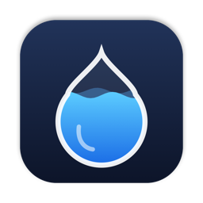

<div align="center">



# liquoten

**在 macOS 菜单栏随时查看大模型订阅额度。**

[English](README.md) | 简体中文

[](https://github.com/h1origin/liquoten/releases/latest)
[](https://github.com/h1origin/liquoten/releases)
[](https://github.com/h1origin/liquoten/actions/workflows/release.yml)
[](LICENSE)


</div>

liquoten 在菜单栏用一滴水显示各个大模型套餐用了多少：剩得越少，水位越低。后台有一个很小的 Go 守护进程，从本地文件或只读接口读取各服务的用量。它不经过你的 API 请求链路。

## ✨ 功能

- **统一查看**：Claude Code、ChatGPT Codex、阿里云百炼 Token Plan、Qoder 的额度都在同一个面板里。
- **菜单栏一眼可见**：水位和颜色跟随最紧张的那一项额度，颜色从蓝变橙再变红，旁边显示剩余百分比。
- **走势图**：每张额度卡片都有用量走势和重置倒计时。5 小时额度按分钟画，每周和月度额度按天画。
- **系统通知**：
  - 额度剩余跌破 50%、20% 时（可配置）
  - 某个服务连续查询失败时
  - Codex 重置卡快过期时
- **隐私、轻量**：
  - 数据只留在本机。凭据只在本地读取，或保存在权限为 `0600` 的配置文件里。
  - CPU 占用几乎为 0，唯一的第三方依赖是 TOML 解析库。
- **App 内更新**：下载 Release 的 dmg、校验 SHA-256，然后替换自身并重新启动。首次从浏览器下载安装仍需放行一次，之后 App 内更新不会再被系统拦下。
- **原生应用**：SwiftUI 菜单栏 App，通用二进制，同时支持 Apple 芯片和 Intel。带开机自启开关。

## 📦 支持的服务

| 服务 | 显示内容 | 数据来源 | 需要配置 |
|---|---|---|---|
| **Claude Code**（Pro / Max） | 5 小时、每周额度 | Claude Code 的 statusLine 输入，由 `liquoten statusline` 落盘 | [加一行 statusLine 配置](#claude-code) |
| **ChatGPT Codex** | 5 小时、每周额度，Credits 余额，重置卡 | 本地 `~/.codex/sessions` 日志，每 30 分钟用 Codex 登录状态调用实时接口校正一次 | 无需配置 |
| **阿里云百炼** Token Plan | 5 小时 / 每周 / 月度额度（取决于套餐） | 签名调用阿里云 OpenAPI 换 token，再查控制台网关 | 在服务页填写 AccessKey |
| **Qoder / Qoder CN** | 本计费周期 Credits 用量、附加 Credits | 个人访问令牌查额度接口 | 在服务页填写令牌 |

## 🚀 安装

### 下载安装（推荐）

1. 到 [Releases](https://github.com/h1origin/liquoten/releases/latest) 下载最新的 `liquoten-x.y.z.dmg`。
2. 打开后把 **liquoten** 拖进「应用程序」。
3. 目前还没有经过苹果签名公证，第一次打开会被系统拦下。任选一种方式放行：
   - 打开「系统设置 → 隐私与安全性」，在页面下方点「仍要打开」；
   - 或在终端执行：

     ```bash
     xattr -dr com.apple.quarantine /Applications/liquoten.app
     ```

需要 macOS 13 Ventura 或更高版本。

### 从源码构建

需要 Go 1.21 及以上（会自动下载 1.27 工具链）和 Xcode Command Line Tools。

```bash
git clone https://github.com/h1origin/liquoten.git && cd liquoten
./app/build.sh                         # 产出 build/liquoten.app
mv build/liquoten.app /Applications/
open /Applications/liquoten.app
```

## 🏁 快速开始

1. 点菜单栏的水滴图标，进入「服务」。
2. 打开你在用的服务。默认什么都不启用。
3. 系统询问通知权限时选允许。
4. 可选：在齿轮菜单里打开「开机自动启动」。

### Claude Code

Claude Code 会把订阅用量传给 [statusLine](https://code.claude.com/docs/en/statusline) 命令。在 `~/.claude/settings.json` 里加上下面这段，服务页也有一键复制按钮：

```json
"statusLine": {
  "type": "command",
  "command": "/Applications/liquoten.app/Contents/Resources/liquoten statusline"
}
```

之后 Claude Code 底部会显示类似 `[Opus] 5h 23% · 周 41%` 的状态，daemon 读取的也是同一份数据。整个过程不碰 OAuth 凭据，也不调用未公开接口。数据只在使用 Claude Code 时更新。

### ChatGPT Codex

不需要配置，liquoten 会读取 `~/.codex/sessions` 里最新的用量。

- **实时校正**：如果你用 ChatGPT 账号登录了 Codex，liquoten 还会每 30 分钟调用一次只读的用量接口来校正数据。这样即使几天没用 CLI，数字也是新的。
- **重置卡**：每 6 小时查一次，最近一张离过期不到 12 小时会发通知提醒。
- **登录凭据**：liquoten 只读取 `~/.codex/auth.json`，不会自己续期令牌，也不会使用你的重置卡。

### 阿里云百炼

在「服务」页百炼那一行填写 AccessKey ID 和 Secret，保存前会实际查询一次来验证。

- **建议**：使用只授予百炼权限的 RAM 子账号。
- **存储**：AccessKey 以明文保存在 `~/.config/liquoten/config.toml`（权限 `0600`），关闭服务时删除。

## ⚙️ 配置

配置文件在 `~/.config/liquoten/config.toml`。服务页会帮你修改它，全部选项见 [config.example.toml](config.example.toml)。

```toml
poll_interval = "1m"              # 带 ±10% 抖动
alert_remaining = [50.0, 20.0]    # 剩余跌破这些百分比时提醒；[] 关闭
notify = "app"                    # 不运行 App 时改为 "osascript"

[providers.codex]                 # 出现 [providers.<name>] 即启用

[thresholds.claudecode]           # 额外提醒点，按已用百分比
"5-hour quota" = 80.0
```

| 环境变量 | 作用 |
|---|---|
| `LIQUOTEN_CONFIG` | 配置文件路径（默认 `~/.config/liquoten/config.toml`） |
| `LIQUOTEN_CACHE_DIR` | 缓存目录（默认 `~/.cache/liquoten`） |
| `CODEX_HOME` | Codex 数据目录（默认 `~/.codex`） |

## 🔧 工作原理

```
各服务 ──► daemon（约每分钟轮询）──► state.json / history.jsonl
                                └──► notifications.jsonl（额度跨过提醒点）
liquoten.app ◄── 读取 state.json，渲染菜单栏并投递通知
```

- **daemon**（Go）：
  - 由 App 拉起，意外退出后自动重启。
  - 结果原子写入，历史追加记录，保留 35 天。
  - 内置一个提醒状态机：每个提醒点只提醒一次，重启后不会重复。
- **App**（Swift）：只读这些文件，两个进程互不依赖内存或进程间通信。
- **数据格式统一**：各服务的数据都归一成 `Section{Name, UsedPct, Remaining, ResetAt}`，界面不用关心是哪个服务。

<details>
<summary><b>命令行</b></summary>

```bash
liquoten -once                         # 只轮询一次
liquoten providers                     # 列出服务及状态（JSON）
liquoten enable|disable <provider>     # 开关服务；disable 会同时删除密钥
liquoten set-access-key <provider>     # 从标准输入读 AccessKey ID 和 Secret，验证后保存
liquoten clear-access-key <provider>
liquoten statusline                    # Claude Code 的 statusLine 命令
```

可执行文件在 `/Applications/liquoten.app/Contents/Resources/liquoten`，可用参数：`-config`、`-cache-dir`。

</details>

## ❓ 常见问题

<details>
<summary><b>提示「无法验证开发者」或打不开</b></summary>

目前还没有签名公证，按上面[安装](#-安装)里的方法放行即可。首次从浏览器下载的 dmg 仍需这样放行一次；之后通过 liquoten 的 App 内更新安装的版本不会被系统隔离。
</details>

<details>
<summary><b>收不到通知</b></summary>

- 在「系统设置 → 通知」里允许 liquoten，并确认勿扰模式没开。
- 检查配置里 `notify` 是否是 `"app"`。
</details>

<details>
<summary><b>百炼提示没有 AccessKey 或没有权限</b></summary>

- 在服务页填写 AccessKey。
- 如果报 `NotAuthorised`，给 RAM 子账号授予百炼权限，等几分钟生效。
</details>

<details>
<summary><b>和官方控制台的数字不一致</b></summary>

- 最多有一个轮询间隔的延迟。
- Claude Code 的数据只在使用时更新。
- Codex 每 30 分钟至少用实时数据校正一次。
</details>

<details>
<summary><b>日志和数据在哪里</b></summary>

- 日志：`~/Library/Logs/liquoten.log`
- 状态：`~/.cache/liquoten/state.json`
- 配置：`~/.config/liquoten/config.toml`
</details>

<details>
<summary><b>卸载</b></summary>

```bash
osascript -e 'quit app "liquoten"' && rm -rf /Applications/liquoten.app
rm -rf ~/.cache/liquoten ~/.config/liquoten
```
</details>

## 🗺️ 路线图

- [ ] 百炼用量包余额、按模型的免费额度
- [ ] 桌面小组件（WidgetKit）
- [ ] 签名公证
- [ ] 更多服务：OpenAI API、Anthropic API、DeepSeek、OpenRouter

## 🤝 参与贡献

欢迎提 Issue 和 PR。

新增服务的步骤：
1. 在 `internal/providers/<name>/` 实现 `providers.Provider` 接口。
2. 在 `init()` 里调用 `providers.Register` 注册。
3. 在 `cmd/liquoten/main.go` 里加一行空白导入（`import _`）。
4. 在 `testdata/` 放一份录制的接口响应，配一个解析单测。

分层和约定见 [AGENTS.md](AGENTS.md)。提交 PR 前请运行：

```bash
go test ./... && go vet ./... && test -z "$(gofmt -l .)"
```

推送 `v*` 标签会自动打包通用版 dmg 并发布 GitHub Release（[release.yml](.github/workflows/release.yml)）。

## 📄 许可证

[MIT](LICENSE) © 2026 Origin
